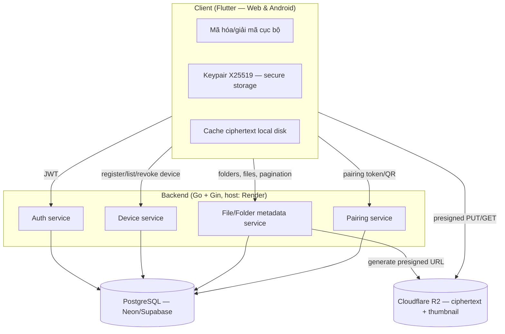
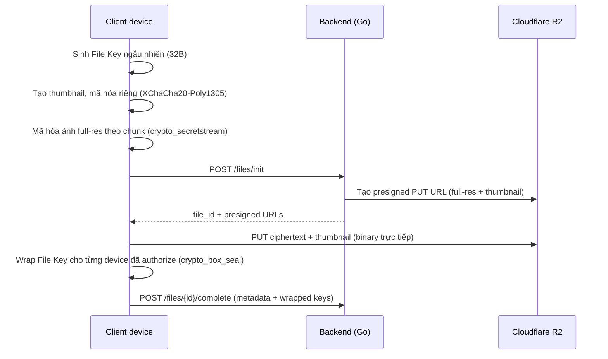
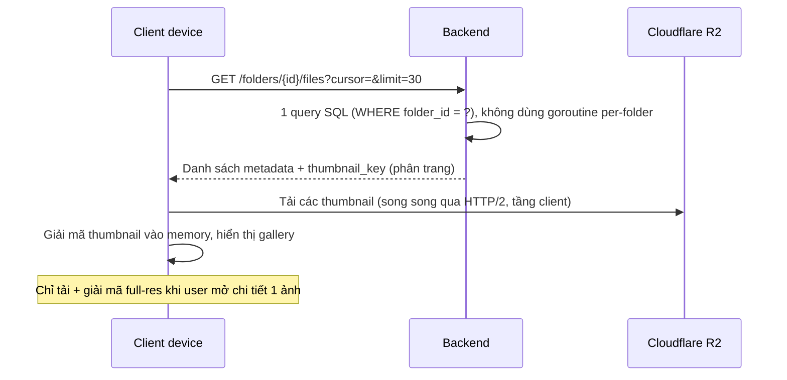
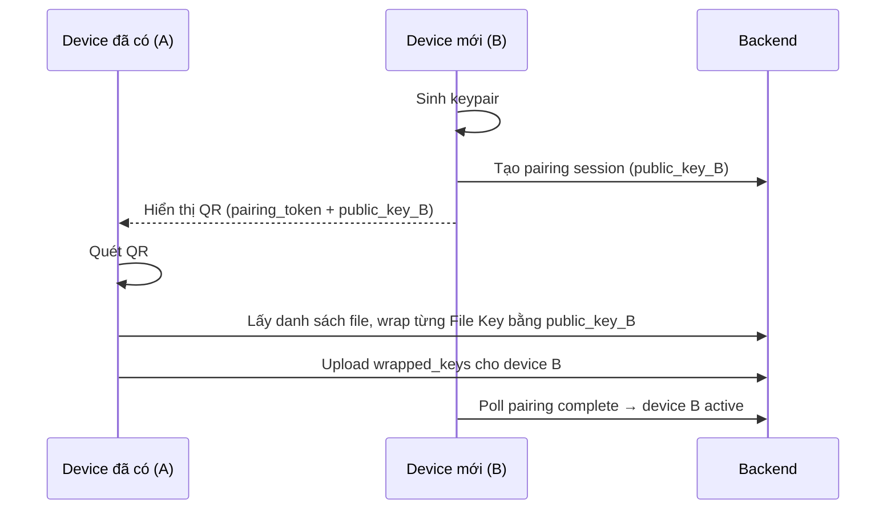

# Secure Photo Vault — Spec tổng hợp

Cross-platform (web desktop + Android) app lưu trữ ảnh mã hóa đầu-cuối, lấy cảm hứng từ Samsung Knox Secure Folder nhưng cho phép truy cập từ nhiều thiết bị dựa trên authorization key.

## 1. Nguyên tắc cốt lõi

Server (backend + object storage) **không bao giờ** có khả năng giải mã nội dung — chỉ lưu ciphertext và các bản wrapped-key. Ngay cả khi bị truy cập trái phép, dữ liệu vẫn vô nghĩa nếu không có private key nằm trên thiết bị người dùng.

## 2. Functional requirements

- Đăng ký / đăng nhập
- Upload ảnh (JPEG/PNG), mã hóa client-side trước khi gửi đi
- Tổ chức ảnh theo folder (giống Secure Folder của Knox)
- Xem/tải lại ảnh từ bất kỳ thiết bị nào đã được authorize
- Gallery + thumbnail, load nhanh kể cả khi có nhiều ảnh
- Authorize (pair) thiết bị mới qua QR code
- Revoke thiết bị (mất máy, đổi máy)

## 3. Non-functional requirements

- E2EE thật sự — không chỉ dừng ở TLS
- Presigned URL (upload/download R2) hết hạn ngắn (5–15 phút)
- Rate limit API chống brute-force
- Object key trên storage dùng UUID random, không dùng tên file gốc
- List/xem ảnh phải chịu được số lượng lớn mà không chậm (pagination, thumbnail riêng)
- Ngoài phạm vi hiện tại: hỗ trợ thêm PDF/Word docs (giai đoạn sau)

## 4. Tech stack đã chốt

| Layer | Lựa chọn | Ghi chú |
|---|---|---|
| Frontend | Flutter (Web + Android) | 1 codebase, 1 bộ crypto logic dùng chung (libsodium binding) |
| Backend | Go + Gin | REST API, phát triển nhanh, ecosystem middleware sẵn |
| Crypto | libsodium | XChaCha20-Poly1305 (content), X25519 sealed box (wrap key) |
| Object storage | Cloudflare R2 | S3-compatible, free tier 10GB, egress miễn phí vĩnh viễn |
| Database | PostgreSQL | Metadata, wrapped keys, device/folder info |
| Hosting backend | Render (free web service) | **Không cần thẻ** — tránh rủi ro billing đã gặp với Oracle/DigitalOcean. Đánh đổi: sleep sau 15 phút idle, cold start ~1 phút |
| Hosting database | Neon hoặc Supabase (free tier) | **Không cần thẻ**, free tier vĩnh viễn (không phải credit có hạn) |

> Lưu ý: Oracle Cloud và DigitalOcean bị loại khỏi lựa chọn vì gặp vấn đề đăng ký/billing (bị trừ tiền nhưng không tạo được account, hoặc credit có hạn dùng hết). Ưu tiên các dịch vụ free tier thật sự, không yêu cầu thẻ.

## 5. Kiến trúc hệ thống

### 5.1 Sơ đồ tổng thể



### 5.2 Luồng upload



### 5.3 Luồng xem gallery (tối ưu hiệu năng)



### 5.4 Luồng authorize thiết bị mới



## 6. Crypto chi tiết

| Mục đích | Thuật toán | Ghi chú |
|---|---|---|
| Mã hóa nội dung ảnh | **XChaCha20-Poly1305** qua `crypto_secretstream` (libsodium) | Nonce 192-bit — tránh rủi ro trùng nonce khi nhiều thiết bị tự sinh random độc lập; mã hóa theo chunk (~64KB), stream được, chống truncation attack |
| Wrap File Key cho từng device | **`crypto_box_seal`** (X25519 + XSalsa20-Poly1305) | "Sealed box" — chỉ cần public key thiết bị nhận, không cần keypair riêng ở người gửi |
| Lưu private key trên thiết bị | Secure storage hệ điều hành | Keychain (iOS/macOS), Keystore (Android), non-extractable key (WebCrypto) qua `flutter_secure_storage` |

Vì sao XChaCha thay vì AES-GCM: nonce 96-bit của AES-GCM có rủi ro trùng thật ở quy mô nhiều thiết bị/nhiều file nếu sinh ngẫu nhiên độc lập; XChaCha's 192-bit nonce loại bỏ rủi ro này, đồng thời có sẵn native trong libsodium (không cần thêm thư viện AES riêng).

## 7. Database schema

```sql
users(id, email, created_at)
devices(id, user_id, public_key, name, created_at, revoked_at)
folders(id, user_id, name, created_at)
files(id, user_id, folder_id, r2_object_key, r2_thumbnail_key, size, content_type, nonce, created_at)
file_keys(file_id, device_id, wrapped_key)  -- 1 dòng / device / file
```

Index quan trọng: `files(folder_id)`, `files(user_id)` — đủ để list nhanh mà không cần concurrency ở tầng ứng dụng.

## 8. API endpoints cơ bản

- `POST /auth/register`, `POST /auth/login`
- `POST /devices/register`, `GET /devices`, `POST /devices/{id}/revoke`
- `GET /folders`, `POST /folders`
- `POST /files/init` — trả về file_id + presigned PUT URL (full-res + thumbnail)
- `POST /files/{id}/complete` — client báo upload xong, gửi wrapped_key theo từng device
- `GET /folders/{id}/files?cursor=&limit=` — list phân trang theo folder
- `GET /files/{id}/download` — presigned GET URL (full-res) + wrapped_key cho device đang request
- `GET /files/{id}/thumbnail` — presigned GET URL cho thumbnail
- `POST /pairing/start`, `POST /pairing/complete`

## 9. Xử lý hiệu năng khi list/xem nhiều ảnh

Vấn đề gốc: tải + giải mã ảnh là bottleneck, không phải query metadata. Thứ tự ưu tiên xử lý:

1. **Pagination cursor-based** cho danh sách — 20–30 item/lần, không trả nguyên list
2. **Thumbnail mã hóa riêng, nhỏ** — chỉ tải/giải mã full-res khi user mở chi tiết
3. **Cache ciphertext ở local disk** (client), giải mã vào memory mỗi lần hiển thị — không cache plaintext ra disk (tránh làm yếu mô hình bảo mật)
4. List theo folder = **1 query SQL** (`WHERE folder_id = ?`) — không dùng goroutine per-folder (rủi ro vượt `max_connections` của Postgres, và Postgres tự tối ưu 1 query tốt hơn N query song song)
5. Concurrency có ý nghĩa thật sự nằm ở **tầng client** tải nhiều thumbnail song song qua HTTP/2 multiplexing, không phải ở tầng DB

## 10. MVP roadmap

1. **Phase 1**: 1 thiết bị — auth + upload/download mã hóa cơ bản (chứng minh luồng E2EE chạy đúng)
2. **Phase 2**: Pairing/authorize thêm thiết bị qua QR
3. **Phase 3**: Folder, thumbnail + gallery UI có pagination, revoke device

## 11. Rủi ro / lưu ý bảo mật cần nhớ

- Revoke thiết bị chỉ chặn truy cập *tương lai* — data đã tải về trước đó không thu hồi lại được
- Metadata (filename, size, timestamp) có thể lộ thông tin dù nội dung đã mã hóa
- Cần cân nhắc cơ chế backup/recovery key (trade-off giữa bảo mật tuyệt đối và khả năng khôi phục khi mất hết thiết bị)
- Tránh base64-encode ciphertext khi truyền tải (tăng ~33% dung lượng) — luôn upload binary trực tiếp qua presigned URL
- Cache plaintext ra disk (kể cả trong sandbox app) làm yếu mô hình bảo mật — chỉ cache ciphertext, giải mã vào memory khi cần hiển thị

## 12. Lưu ý hosting/billing

- Oracle Cloud và DigitalOcean: gặp vấn đề đăng ký/billing (trừ tiền nhưng không tạo được account, hoặc credit dùng hết) → không dùng
- Ưu tiên dịch vụ **free tier vĩnh viễn, không yêu cầu thẻ**: Render (backend), Neon/Supabase (database)
- Nếu sau này cần nâng cấp hiệu năng (bỏ cold-start của Render): cân nhắc trả phí tier thấp nhất thay vì quay lại các gói "free nhưng cần thẻ"