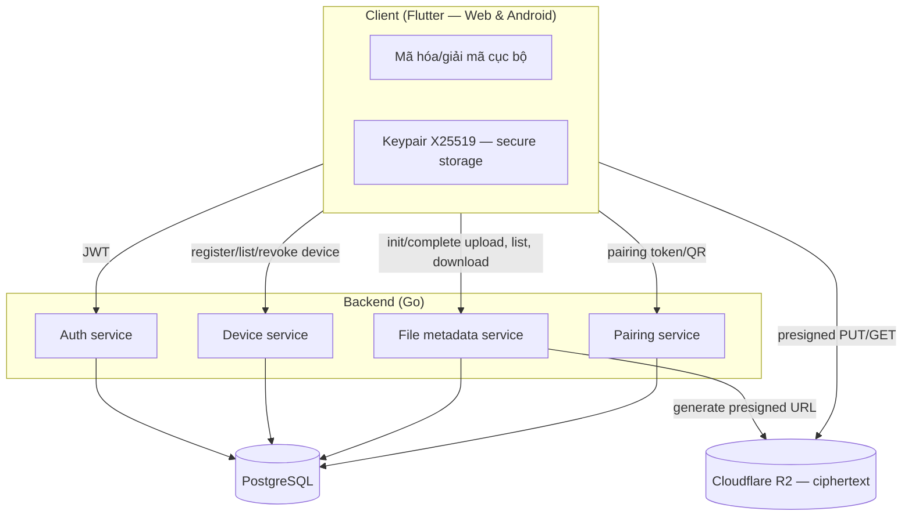
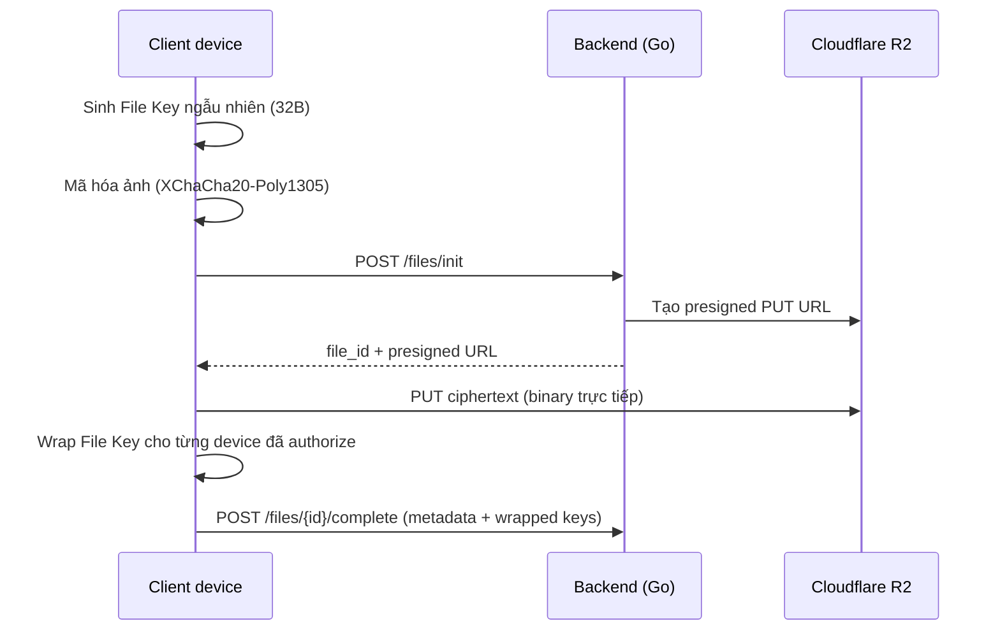
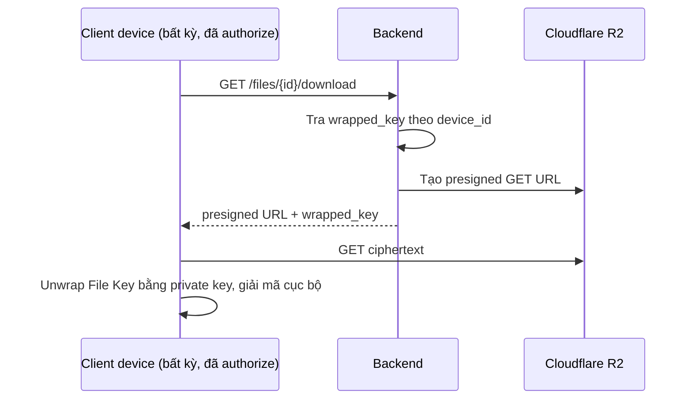
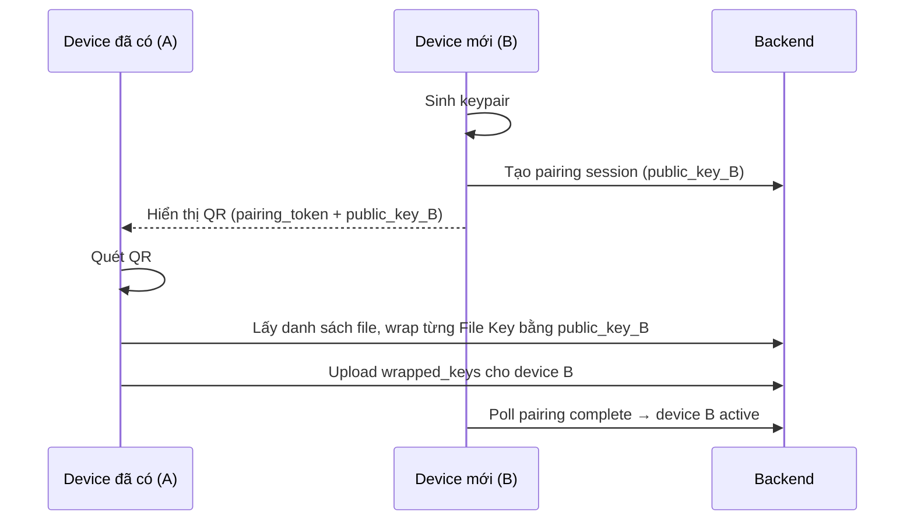

# Secure Photo Vault — Tài liệu kỹ thuật sơ bộ

Cross-platform (web desktop + Android) app lưu trữ ảnh mã hóa đầu-cuối, lấy cảm hứng từ Samsung Knox Secure Folder nhưng cho phép truy cập từ nhiều thiết bị dựa trên authorization key.

## 1. Nguyên tắc cốt lõi

Server (Cloudflare R2 + backend) **không bao giờ** có khả năng giải mã nội dung — chỉ lưu ciphertext và các bản wrapped-key. Ngay cả khi bị truy cập trái phép, dữ liệu vẫn vô nghĩa nếu không có private key nằm trên thiết bị người dùng.

## 2. Functional requirements

- Đăng ký / đăng nhập
- Upload ảnh (JPEG/PNG), mã hóa client-side trước khi gửi đi
- Xem/tải lại ảnh từ bất kỳ thiết bị nào đã được authorize
- Gallery + thumbnail
- Authorize (pair) thiết bị mới qua QR code
- Revoke thiết bị (mất máy, đổi máy)

## 3. Non-functional requirements

- E2EE thật sự — không chỉ dừng ở TLS
- Presigned URL (upload/download R2) hết hạn ngắn (5–15 phút)
- Rate limit API chống brute-force
- Object key trên R2 dùng UUID random, không dùng tên file gốc
- Ngoài phạm vi hiện tại: hỗ trợ thêm PDF/Word docs (giai đoạn sau)

## 4. Kiến trúc hệ thống

### 4.1 Sơ đồ tổng thể



### 4.2 Luồng upload



### 4.3 Luồng download



### 4.4 Luồng authorize thiết bị mới



### 4.5 Thành phần & vai trò

| Component | Vai trò | Stack gợi ý |
|---|---|---|
| Client | Sinh key, mã hóa/giải mã, giữ private key | Flutter (web + Android), libsodium |
| Auth service | Đăng ký/login, JWT | Go |
| Device service | Đăng ký public key, list/revoke | Go + PostgreSQL |
| File metadata service | Điều phối presigned URL, lưu wrapped keys | Go + PostgreSQL |
| Pairing service | Relay pairing token/QR, không thấy key | Go |
| Object storage | Lưu ciphertext | Cloudflare R2 |

## 5. Database schema (cơ bản)

```sql
users(id, email, created_at)
devices(id, user_id, public_key, name, created_at, revoked_at)
files(id, user_id, r2_object_key, size, content_type, nonce, created_at)
file_keys(file_id, device_id, wrapped_key)  -- 1 dòng / device / file
```

## 6. API endpoints cơ bản

- `POST /auth/register`, `POST /auth/login`
- `POST /devices/register`, `GET /devices`, `POST /devices/{id}/revoke`
- `POST /files/init` — trả về file_id + presigned PUT URL
- `POST /files/{id}/complete` — client báo upload xong, gửi wrapped_key theo từng device
- `GET /files` — list metadata
- `GET /files/{id}/download` — presigned GET URL + wrapped_key cho device đang request
- `POST /pairing/start`, `POST /pairing/complete`

## 7. Storage — Cloudflare R2

- 1 bucket riêng, object key dạng `user_id/uuid`
- CORS bật cho presigned PUT/GET từ domain web app
- Free tier: 10 GB storage, 1 triệu Class A operations, 10 triệu Class B operations/tháng, egress miễn phí hoàn toàn

## 8. MVP roadmap

1. **Phase 1**: 1 thiết bị — auth + upload/download mã hóa cơ bản (chứng minh luồng E2EE chạy đúng)
2. **Phase 2**: Pairing/authorize thêm thiết bị qua QR
3. **Phase 3**: Thumbnail + gallery UI, revoke device

## 9. Rủi ro / lưu ý bảo mật cần nhớ

- Revoke thiết bị chỉ chặn truy cập *tương lai* — data đã tải về trước đó không thu hồi lại được
- Metadata (filename, size, timestamp) có thể lộ thông tin dù nội dung đã mã hóa
- Cần cân nhắc cơ chế backup/recovery key (trade-off giữa bảo mật tuyệt đối và khả năng khôi phục khi mất hết thiết bị)
- Tránh base64-encode ciphertext khi truyền tải (tăng ~33% dung lượng) — luôn upload binary trực tiếp qua presigned URL